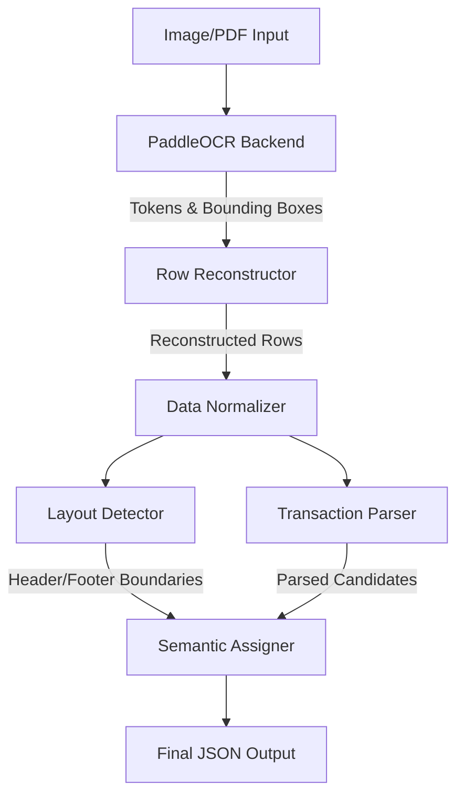
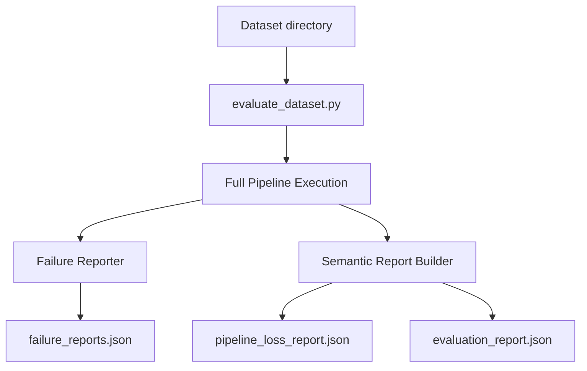

# System Architecture

The `BankStatementParser` is designed as a linear, deterministic pipeline. Rather than relying on black-box machine learning models for natural language understanding, this pipeline applies strict, logic-based spatial reconstruction and regular expressions.

## 1. Pipeline Overview

The high-level data flow operates in a single pass over a bank statement image, progressively refining raw pixels into structured semantic objects.

## 2. Core Components

### PaddleOCR Backend (`src/backends/paddleocr_backend.py`)
- **Purpose:** Acts as the vision layer.
- **Function:** Initializes the PaddleOCR network and extracts text tokens from the source image. Critically, it utilizes `use_angle_cls=True` to handle rotated scans, and passes raw images natively without destructive OpenCV binarization, ensuring maximum legibility on low-contrast photographs.

### Row Reconstructor (`src/transaction_reconstructor.py`)
- **Purpose:** Restores reading order.
- **Function:** Groups individual OCR tokens into logical horizontal rows based on vertical (Y-axis) overlap and proximity. This step prevents multi-column tables from being read linearly.

### Data Normalizer (`src/normalizer.py`)
- **Purpose:** Standardizes syntax.
- **Function:** Normalizes disparate date formats (e.g., `01/04/21`, `Jan 04`) and monetary formats (e.g., handling trailing/leading negative signs and stripping currency symbols) to prepare rows for strict regex matching.

### Layout Detector (`src/layout_detector.py`)
- **Purpose:** Contextual bounding.
- **Function:** Identifies the structural boundaries of the statement by searching for known header and footer keywords (e.g., "Opening Balance", "Total Deposits"). This ensures the semantic assigner knows exactly where the transaction table begins and ends, preventing noise from account metadata.

### Transaction Parser (`src/transaction_parser.py`)
- **Purpose:** Data extraction.
- **Function:** Applies optimized `DATE_RE` and `AMOUNT_RE` regex patterns to candidate rows to extract the Date, Description, and Monetary Amounts. It includes highly-resilient **Stateful Date Tracking** (`last_seen_date`), allowing transactions that span multiple rows or share a single date header to inherit the correct temporal context.

### Semantic Assigner (`src/semantic_assigner.py`)
- **Purpose:** Final validation.
- **Function:** Combines the Parsed Rows with the Layout Boundaries. Any row falling outside the transaction table bounds is discarded. Valid rows are packaged into structured JSON representing the final extracted transactions.

## 3. Evaluation Architecture

The pipeline is benchmarked and tested using a parallel evaluation architecture.

- **`evaluate_dataset.py`**: The main orchestrator that processes batches of images.
- **`failure_reports.json`**: Captures rows that were rejected (e.g., `date_parse_failed`, `insufficient_numeric_values`), enabling highly-targeted forensic debugging.
- **`pipeline_loss_report.json`**: Tracks the conversion funnel for each specific statement (Reconstructed -> Parsed -> Assigned).
- **`evaluation_report.json`**: Aggregates final system metrics and validation confidence scores.
